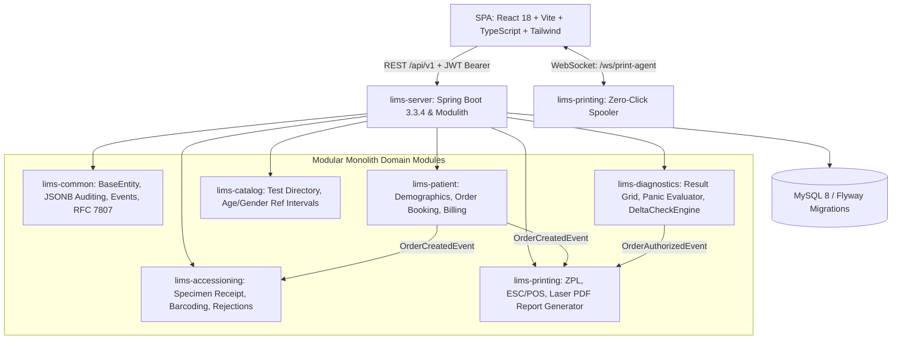

# Enterprise Pathology Laboratory Information Management System (LIMS) MVP

A production-grade, modular, and scalable Pathology Laboratory Information Management System (LIMS) built following Domain-Driven Design (DDD) and Spring Modulith architectural patterns with Java 21, Spring Boot 3.3+, MySQL 8 (PostgreSQL and in-memory H2 profiles also supported) with Flyway, OpenPDF, JWT/RBAC security, and a high-density, keyboard-first React 18 + Vite + TypeScript frontend.

---

## 1. System Architecture & Tech Stack



### Module Breakdown
- **`lims-common`**: Base entity abstractions with optimistic locking, shared DTOs/enums (`Gender`, `OrderStatus`, `SampleStatus`, `RejectionReason`, `ContainerType`), RFC 7807 `ProblemDetail` global exception handler, domain events (`OrderCreatedEvent`, `OrderAuthorizedEvent`, `SampleAccessionedEvent`, `ResultEvaluatedEvent`), and an immutable JSONB `@Auditable` entity listener writing to `audit_logs`.
- **`lims-catalog`**: Medical test catalog directory, multi-tier parameter hierarchies, and age- & gender-specific biological reference intervals with normal and panic thresholds.
- **`lims-patient`**: Duplicate phone verification, unique UHID allocation (`UHID-2026-XXXX`), accession number generation (`ACC-2026-XXXX`), multi-test billing with discount calculation, and diagnostic order persistence.
- **`lims-accessioning`**: Pre-analytical chain of custody, barcode scanner receiving (`/api/v1/accessioning/scan-receive`), and pre-analytical rejection handling (`HEMOLYZED`, `CLOTTED`, `INSUFFICIENT_VOLUME`, etc.).
- **`lims-diagnostics`**: Dynamic age resolution from patient DOB, `CriticalRangeEvaluator` (normal vs panic boundaries), `DeltaCheckEngine` (flags `requiresReview = true` for historical variance > ±25%), and Pathologist Doctor Sign-off stamping SHA-256 cryptographic hashes and verification tokens.
- **`lims-printing`**: Hardware spooler bridge over WebSocket (`/ws/print-agent`) for zero-click silent printing:
  - **`BARCODE_THERMAL`**: Raw ZPL II strings formatted for 2"x1" vacutainer tube thermal stickers (Code 128).
  - **`INVOICE_POS`**: Raw ESC/POS formatted strings with thermal cut commands for 80mm receipt printers.
  - **`REPORT_LASER`**: Accredited clinical A4 PDF diagnostic report byte array with ZXing authenticity QR code and red `#ed1b24` panic flags.
- **`lims-server`**: Runnable Spring Boot application runner, Flyway database schema migrator, and OpenAPI 3 Swagger portal.

---

## 2. Strict UI Design System & Color Tokens

| Token Name | Hex Code | RGB | Purpose |
| :--- | :--- | :--- | :--- |
| **Primary Brand Accent** | `#23408e` | `rgb(35, 64, 142)` | Top navbar, primary CTAs, active states, report banners |
| **Interactive Secondary** | `#385399` | `rgb(56, 83, 153)` | Secondary buttons, subtle row hovers, focus outlines |
| **Critical / Alert / Panic** | `#ed1b24` | `rgb(237, 27, 36)` | Critical panic values, STAT flags, rejection badges, pulse alerts |
| **Border / Gridlines** | `#cccccc` | `rgb(204, 204, 204)` | High-density table gridlines, card borders, form outlines |
| **Surface / Canvas** | `#ffffff` | `rgb(255, 255, 255)` | Main application background, printable clinical A4 report sheets |

### Keyboard-First Operational Shortcuts
- **`Alt + N`**: Clear and prepare new patient registration
- **`Enter`**: Step sequentially to the next form field in registration and the next row in the result grid
- **`Alt + S`**: Save order & auto-spool hardware payloads (or save test results in the grid)

---

## 3. Database Schema (JPA & Flyway)

Database migrations are managed via Flyway (`V1__initial_schema.sql` … `V4__security_hardening_and_event_outbox.sql`); core tables:
1. **`patients`**: `id` (UUID), `uhid` (unique), `first_name`, `last_name`, `dob`, `gender`, `phone`, `email`, `created_at`, `updated_at`, `version`.
2. **`test_catalogs`**: `id`, `test_code` (unique, e.g. CBC, LIPID, LFT, KFT, GLU_F), `test_name`, `department`, `specimen_type`, `container_type`, `price`, `tat_minutes`, `is_active`.
3. **`test_parameters`**: `id`, `test_catalog_id`, `parameter_name`, `unit`, `formula`, `display_order`.
4. **`parameter_reference_ranges`**: `id`, `parameter_id`, `gender` (MALE, FEMALE, ALL), `min_age`, `max_age`, `normal_low`, `normalHigh`, `critical_low`, `critical_high`, `text_normal_val`.
5. **`diagnostic_orders`**: `id`, `accession_number` (unique), `patient_id`, `status` (REGISTERED, COLLECTED, PROCESSING, COMPLETED, AUTHORIZED), `total_amount`, `paid_amount`, `referring_doctor`.
6. **`order_items`**: `id`, `order_id`, `test_catalog_id`, `test_code`, `test_name`, `price`.
7. **`specimen_samples`**: `id`, `order_id`, `accession_number`, `barcode` (unique), `container_type`, `specimen_type`, `status` (COLLECTED, RECEIVED, REJECTED), `rejection_reason`, `rejection_notes`, `collected_at`, `received_at`.
8. **`test_results`**: `id`, `order_id`, `parameter_id`, `parameter_name`, `unit`, `observed_value`, `is_critical`, `is_out_of_range`, `requires_review`, `delta_change_percentage`, `technician_notes`.
9. **`order_authorizations`**: `id`, `order_id` (unique), `pathologist_name`, `license_number`, `digital_signature_hash`, `verification_token`, `authorized_at`.
10. **`audit_logs`**: `id`, `entity_name`, `entity_id`, `action_type`, `changed_by`, `old_data` (JSONB), `new_data` (JSONB), `ip_address`, `timestamp`.

---

## 4. REST API & WebSocket Endpoints

All endpoints except sign-in, public report verification and health probes require `Authorization: Bearer <token>`.
Errors are RFC 7807 `application/problem+json` (validation failures carry `invalidFields`); list endpoints are paged
(`?page=0&size=20&sort=createdAt,desc`) and return `{content, page, size, totalElements, totalPages, first, last}`.

### Authentication & Administration
- `POST /api/v1/auth/login` - Exchange username/password for a JWT (rate-limited; repeated failures lock the account).
- `GET /api/v1/auth/me` / `POST /api/v1/auth/change-password` - Own profile and password.
- `GET|POST /api/v1/admin/users`, `PUT .../{id}/roles`, `PATCH .../{id}/status`, `POST .../{id}/unlock`, `POST .../{id}/reset-password` - Staff accounts (ADMIN).
- `GET /api/v1/admin/audit-logs?entityName=&entityId=` - Immutable audit trail (ADMIN).

| Capability | ADMIN | PATHOLOGIST | TECHNICIAN | RECEPTIONIST |
| :--- | :---: | :---: | :---: | :---: |
| Register / bill | ✓ | | | ✓ |
| View clinical data | ✓ | ✓ | ✓ | ✓ |
| Receive / reject specimens | ✓ | | ✓ | |
| Enter results | ✓ | ✓ | ✓ | |
| Authorize report | | ✓ | | |
| Manage users / audit | ✓ | | | |

### Catalog Directory
- `GET /api/v1/catalog/tests` - Returns all active tests with parameters and reference ranges.
- `GET /api/v1/catalog/tests/code/{code}` - Lookup test by code (e.g. `CBC`).
- `GET /api/v1/catalog/parameters/{id}/reference-range?age=45&gender=MALE` - Resolve age- and gender-specific reference interval.

### Patient & Order Booking
- `POST /api/v1/orders/book` - Unified quick registration & multi-test billing (fires `OrderCreatedEvent`).
- `GET /api/v1/orders` - Paged diagnostic orders, newest first.
- `GET /api/v1/orders/{id}` / `GET /api/v1/orders/accession/{accessionNumber}` - Order with patient demographics and items.
- `GET /api/v1/patients/phone/{phone}` - Duplicate phone lookup before registration (204 when no match).
- `GET /api/v1/patients/search?query=` - Paged patient search.

### Specimen Accessioning
- `POST /api/v1/accessioning/scan-receive` - Barcode scan receipt transitioning sample to `RECEIVED`.
- `POST /api/v1/accessioning/reject` - Rejection endpoint capturing reasons (`HEMOLYZED`, `CLOTTED`, etc.).
- `GET /api/v1/accessioning/samples?status=` - Paged worklist (`COLLECTED`, `RECEIVED`, `REJECTED`).
- `GET /api/v1/accessioning/samples/order/{orderId}` - Samples of one order.

### Diagnostics & Result Entry
- `POST /api/v1/diagnostics/results/batch` - Batch result submission executing `CriticalRangeEvaluator` and `DeltaCheckEngine` (rejected once authorized).
- `GET /api/v1/diagnostics/results/order/{orderId}` - Fetch order results with evaluation flags.
- `POST /api/v1/diagnostics/authorize` - Pathologist sign-off stamping digital signature and firing `OrderAuthorizedEvent`.
- `GET /api/v1/diagnostics/verify/{token}` - Public authenticity certificate verification (no patient data).

### Zero-Click Hardware Spooling & PDF Reports
- `GET /api/v1/printing/pdf/{orderId}` - Clinical A4 diagnostic PDF report (`Cache-Control: no-store`).
- `GET /api/v1/printing/jobs` / `GET /api/v1/printing/status` - Recent print queue payloads and agent status.
- `POST /api/v1/printing/spool/report/{orderId}` - Re-spools laser report to hardware agent.
- `WS /ws/print-agent?access_token=<jwt>` - Authenticated WebSocket for local silent print agents (browsers cannot set headers on the upgrade).

---

## 5. Running the Application

### Prerequisites
- Java 21+ LTS, Apache Maven 3.9+
- Node.js 20+ & npm 10+
- MySQL 8 for the default profile, or none at all with the in-memory `dev` profile
- Docker (optional) for the compose stack and Testcontainers integration tests

### Local development (no database install)
```bash
# Backend on :8080 with in-memory H2 and seeded demo data
cd backend
mvn clean install -DskipTests
SPRING_PROFILES_ACTIVE=dev java -jar lims-server/target/lims-server-1.0.0-SNAPSHOT.jar

# Frontend on :3000 (proxies /api and /ws to :8080)
cd frontend
npm install
npm run dev
```
- Web application: `http://localhost:3000` (demo accounts are listed on the sign-in page in development)
- Swagger UI: `http://localhost:8080/swagger-ui.html` (disabled in the `prod` profile)

| Demo account | Password | Role |
| :--- | :--- | :--- |
| `admin` | `admin123` | All roles (change on first use; `prod` refuses to start with it) |
| `reception` | `Reception@123` | Front desk |
| `technician` | `Technician@123` | Lab technician |
| `pathologist` | `Pathologist@123` | Pathologist |

Backend profiles: `mysql` (default), `postgres`, `dev` (H2), plus `prod` hardening (requires `LIMS_JWT_SECRET`,
`LIMS_CORS_ALLOWED_ORIGINS` and `LIMS_BOOTSTRAP_ADMIN_PASSWORD`; disables demo data and Swagger; JSON logs).

### Frontend configuration (`frontend/.env.example`)
| Variable | Default | Purpose |
| :--- | :--- | :--- |
| `VITE_API_BASE_URL` | `/api/v1` | REST base (same origin via dev proxy / nginx) |
| `VITE_PRINT_AGENT_WS_URL` | derived from page host | Print-agent WebSocket URL |
| `VITE_APP_ENV` | build mode | Environment badge in the navbar (hidden for `production`) |
| `VITE_SHOW_DEMO_ACCOUNTS` | `false` | Show demo accounts on sign-in (dev only) |
| `DEV_PROXY_TARGET` | `http://localhost:8080` | Dev-server proxy target (not bundled) |

### Docker Compose (MySQL + API + nginx-served SPA)
```bash
cp .env.example .env     # set MYSQL_*, LIMS_JWT_SECRET, LIMS_BOOTSTRAP_ADMIN_PASSWORD
docker compose up --build
```
The application is served at `http://localhost:8081`; nginx reverse-proxies `/api` and `/ws` to the backend, applies
security headers (CSP, no framing), caches hashed assets and serves SPA deep links such as `/verify/<token>`.

---

## 6. Frontend Architecture

```
frontend/src
├── auth/          AuthProvider (sessionStorage JWT, expiry timer, 401 → sign-in), permission matrix, route guards
├── lib/           http client (bearer token, RFC 7807 → ApiError), clinical evaluation, formatting, print payload parsing
├── schemas/       zod schemas mirroring backend validation (booking, clinical, auth, admin)
├── services/api.ts  typed endpoint functions
├── hooks/         print-agent WebSocket (backoff reconnect), order worksheet loader, Alt+key hotkeys
├── components/    layout (navbar, shell), ui (toasts, error boundary, modal, skeletons, pagination, fields)
└── pages/         one lazily loaded chunk per route
```
- Sessions live in `sessionStorage` (per tab, cleared on close), which suits shared lab workstations.
- The UI hides actions a role cannot perform, but the server enforces every rule independently.
- Result entry previews reference-interval/panic flags while typing; the server re-evaluates on save and its flags are authoritative. Sign-off requires saved results and an explicit review attestation.

---

## 7. Testing & CI

```bash
cd backend && mvn verify        # unit + Spring Modulith tests; Testcontainers ITs run when Docker is available
cd frontend && npm run typecheck && npm test && npm run build
```
`.github/workflows/ci.yml` runs both suites on every push/PR and builds the backend and frontend container images.
